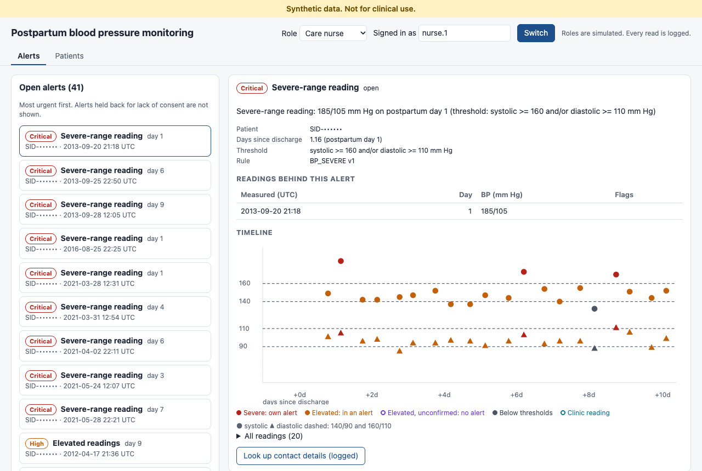
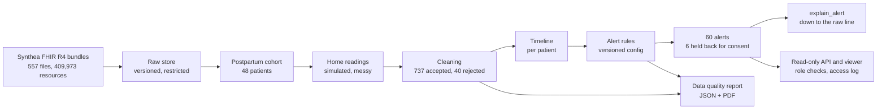
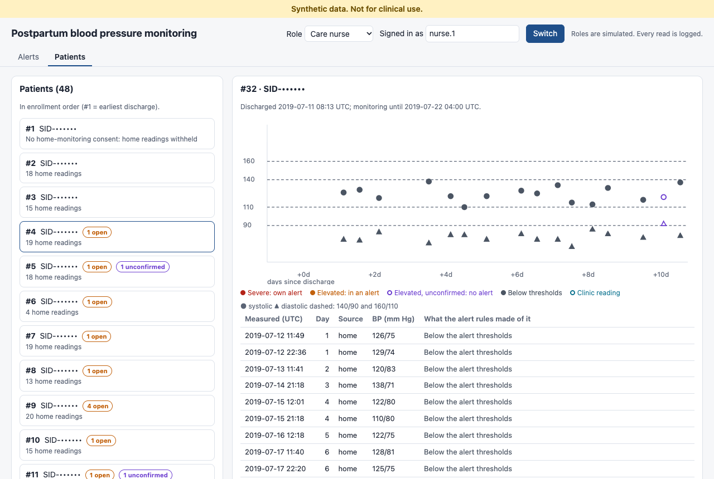
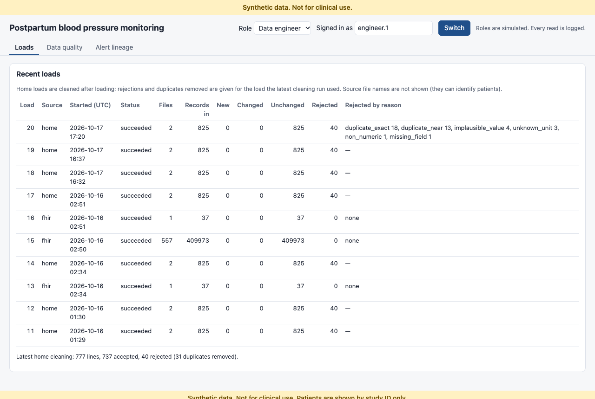
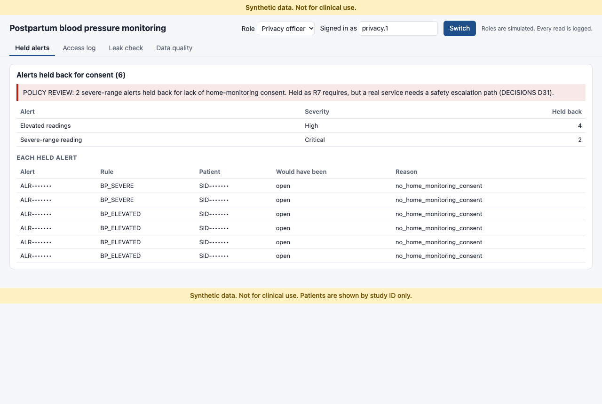

# Postpartum Blood Pressure Data Pipeline with Lineage

> **Synthetic data. Not for clinical use.** This is a data engineering demonstration built on Synthea synthetic patients [[1]][[2]] and simulated home readings. It makes no claim of clinical validity, accuracy, or outcomes.

This pipeline brings EHR records (FHIR R4) and messy home blood pressure readings together for patients monitored after delivery. It cleans the readings, aligns them to days since discharge, and raises alerts from versioned rules. Every alert traces back to the exact raw records and the rule version that produced it. Identifying data stays in restricted zones, every read is logged, and a data quality report scores the run.



## Contents

- [Why postpartum blood pressure](#why-postpartum-blood-pressure)
- [What it does](#what-it-does)
- [Quick start](#quick-start)
- [Data and standards](#data-and-standards)
- [Home readings (simulated)](#home-readings-simulated)
- [Alerts](#alerts)
- [Lineage: explaining an alert](#lineage-explaining-an-alert)
- [Privacy](#privacy)
- [Data quality report](#data-quality-report)
- [Viewer and API](#viewer-and-api)
- [How this builds on DataTrust AI](#how-this-builds-on-datatrust-ai)
- [Tech stack](#tech-stack)
- [Testing and verification](#testing-and-verification)
- [Limitations](#limitations)
- [Project documents](#project-documents)
- [Sources](#sources)

## Why postpartum blood pressure

Hypertensive disorders of pregnancy (HDP) were recorded in 15.9% of US delivery hospitalizations in 2019, up from 13.3% in 2017 [[3]]. ACOG recommends a blood pressure check no later than 7–10 days postpartum for patients with HDP, and within 72 hours for those with severe hypertension. It notes that more than half of postpartum strokes occur within 10 days of discharge [[4]].

This project builds the data side of that follow-up: home readings and EHR records combined in one pipeline, where every alert can be traced back to the records that produced it. It serves three users:

- **A care nurse:** who needs attention now, and why.
- **A data engineer:** what came in, what changed, what was rejected, and why.
- **A privacy officer:** who saw which patient's data, and whether the data was allowed to be used.

## What it does



| Stage | What happens | On this data |
|---|---|---|
| 1. Explore | Profile the Synthea sample and walk through one patient's record. | 555 patients |
| 2. Ingest | Load every FHIR resource into a versioned raw store, with new/changed/unchanged detection and idempotent reloads. | 409,973 resources, 0 rejected |
| 3. Cohort | Anchor on each patient's most recent delivery. Native HDP from the record, plus a seeded, tagged synthetic HDP for half of the rest. | 84 delivery patients, 48 in the cohort (11 native, 37 augmented) |
| 4. Home readings | Simulate twice-daily readings for 10 days, with realistic problems, then clean them: UTC timestamps, unit conversion, time-zone correction, deduplication, and a reason for every rejection. | 777 submissions, 737 accepted, 40 rejected |
| 5. Alerts | Versioned rules with per-record results; `explain_alert` down to the raw line. | 60 alerts |
| 5b. Privacy | Study IDs instead of record numbers, consent gating, an access log, and a leak check. | 6 alerts held back, leak check passing |
| 6. Quality | A data quality score in DataTrust AI's style, with every deduction traced to records. | 99.02 / 100 |
| 7. Viewer | A read-only API and viewer for the three users. | Every read logged |

All counts come from the pipeline's own output on the pinned sample (see [DECISIONS.md](DECISIONS.md)).

## Quick start

You need Python 3.11, `make`, and about 2.5 GB of disk: the sample is 95 MB zipped and 1.1 GB unzipped, and the database is about 1.2 GB. Tested on macOS.

```bash
make setup              # virtualenv + download the Synthea FHIR R4 sample (checksum-verified)
make ingest             # Phase 2: load the FHIR bundles into DuckDB; safe to re-run
make cohort             # Phase 3: build the postpartum cohort (config/cohort.toml)
make home               # Phase 4: simulate, load and clean home readings; build timelines; reconcile
make alerts             # Phase 5: run the alert rules (config/rules.toml); list open alerts
make privacy            # Phase 5b: rebuild the restricted contact table, then run the leak check
make report             # Phase 6: data quality report (JSON + PDF), then the leak check
make serve              # Phase 7: viewer and read-only API on http://127.0.0.1:8000/ (PORT=... to change)
make test               # the test suite
```

Other targets:

- `make explore`, `make walkthrough`: Phase 1 exploration.
- `make explain ID=ALR-...`: one alert's full lineage.
- `make leak-check-history`: the leak check over every commit, run before any push.

The database goes to `data/ppbp.duckdb`. The pseudonym key is generated on first use in `data/secrets/` and never committed. If the project sits in an iCloud-synced folder, keep `data/` off iCloud with `mv data data.nosync && ln -s data.nosync data` (DECISIONS D11), or set `PPBP_DB_PATH` to put the database elsewhere.

## Data and standards

- **Source data:** Synthea's published sample, `synthea_sample_data_fhir_r4_nov2021.zip` [[5]], in FHIR R4 (v4.0.1) [[6]]. `make setup` pins it by SHA-256 (DECISIONS D1).
- **This project's numbers** come from the pipeline's own output, not from external sources. `make ingest` loads 557 bundles (555 patients) holding 409,973 resources. `make cohort` finds 84 patients with a delivery and builds a cohort of 48: 11 with a native HDP diagnosis and 37 with a synthetic, tagged one (DECISIONS D3, D12–D15).

| What | Code | Source |
|---|---|---|
| Blood pressure panel | LOINC 85354-9 | [[7]][[8]] |
| Systolic blood pressure | LOINC 8480-6 | [[7]][[8]] |
| Diastolic blood pressure | LOINC 8462-4 | [[7]][[8]] |
| BP unit | UCUM `mm[Hg]` | [[7]] |
| Pre-eclampsia (native HDP) | SNOMED CT 398254007 | [[9]] |
| Eclampsia in pregnancy (native HDP) | SNOMED CT 198992004 | [[9]] |
| Pregnancy-induced hypertension (synthetic HDP) | SNOMED CT 48194001 | [[9]] |

The three SNOMED CT codes are all members of HL7's *Hypertensive Disorders of Pregnancy SNOMED CT* value set [[9]].

## Home readings (simulated)

The simulated protocol follows the Heart Safe Motherhood program: readings twice daily for 10 days after discharge [[11]]. That covers ACOG's 7–10 day check [[4]]. The length can be set up to 42 days; a hospital-level program has monitored patients until 6 weeks postpartum [[12]].

**Messiness is injected on purpose:**
- dropouts and missed readings;
- duplicates and late arrivals;
- wrong time zones;
- impossible values and unit errors.

The rates are assumptions, recorded in DECISIONS D21.

**Cleaning:** on the 48-patient cohort, `make home` produces 777 submissions. Cleaning accepts 737 and rejects 40, each with a reason.

**Reconciliation:** `make home` checks two things and fails if either is off.
- **Counts:** every count, from scheduled readings to accepted and rejected, adds up.
- **Injected problems:** every problem injected into a line was handled, checked line by line (DECISIONS D22–D23).

## Alerts

The alert rules in `config/rules.toml` use ACOG's definitions [[10]]:
- **Hypertension in pregnancy:** systolic ≥140 mm Hg and/or diastolic ≥90 mm Hg. Gestational hypertension first appears after 20 weeks of pregnancy.
- **Severe range:** systolic ≥160 mm Hg and/or diastolic ≥110 mm Hg.

| Rule | Severity | When it fires |
|---|---|---|
| Severe-range reading | Critical | Every severe-range home reading raises its own alert. |
| Elevated readings | High | One alert per patient, once there are 2+ elevated readings at least 4 hours apart. Later elevated readings attach to it, and it closes after 48 hours without one. |
| No readings for 36+ hours | Medium | A patient goes quiet. No readings is never treated as normal readings, and nothing fires after a patient's death. |

**Where the numbers come from:**
- **The 4 hours** follows the ACOG diagnostic criterion of ≥140/90 on two occasions at least 4 hours apart, as summarized in [[13]] and [[14]]. That criterion is for diagnosis during pregnancy; applying it to postpartum home readings is this project's choice.
- **The 2-reading minimum, the 48-hour close and the 36-hour silence** are this project's assumptions (DECISIONS D25–D26). They have no external source.

**Before and after.** Moving elevated readings from one alert per reading to one episode alert per patient cut alerts from 172 to 60 on the 48-patient cohort. Severe alerts didn't change: the same 11.

| Rule | Alerts before | Alerts after | Patients before | Patients after |
|---|---|---|---|---|
| Severe-range reading (Critical) | 11 | 11 | 6 | 6 |
| Elevated readings (High) | 143 | 31 | 29 | 25 |
| No readings for 36+ hours (Medium) | 18 | 18 | 18 | 18 |
| **Total** | **172** | **60** | **36** | **33** |

**Fewer alerts, nothing hidden.** Elevated readings that weren't confirmed by a second one raise no alert. They stay visible on the patient's timeline, marked "elevated, unconfirmed", so the reduction is prioritization rather than hidden data (DECISIONS D42). The per-patient comparison is in DECISIONS D26.



## Lineage: explaining an alert

`make explain ID=ALR-...` (or the engineer's "Alert lineage" view) returns everything behind one alert:

- **The rule:** its ID, version and parameters, its source, and the SHA-256 of the rules file for that run.
- **The rule result** for every record that contributed.
- **Each cleaned reading:** including the timestamp exactly as submitted, and any correction flags such as `tz_corrected`.
- **Each raw line,** redacted: the record number and device ID are withheld, and the original line's SHA-256 is kept so anyone with raw-zone access can verify it.
- **The load and file hash** that brought each line in, and the cleaning run's config hash.
- **The patient's readings** in the 48 hours before the alert.

## Privacy

- **Study IDs:** outside two restricted zones, patients appear only as a study ID (`SID-...`), a keyed hash of the record number. The key never enters git. The record-number mapping and contact details live in the restricted `phi` schema. The raw FHIR and home-export data live in `raw` (DECISIONS D30, D33).
- **Consent:** alerts for patients without home-monitoring consent are held back from the nurse's list, with the reason recorded per alert. On this cohort that's 6 of 60 alerts (D31).
- **Access:** every read of an alert, timeline or contact detail goes through an access layer. It checks the role's permissions (`config/access.toml`) and logs who read what and when, including denied attempts (D32).
- **Leak check:** `make leak-check` looks for record numbers, names, phones, identifiers, addresses and birth dates. It scans:
  - every table outside the restricted zones;
  - every log and report, including the PDF;
  - every response the access layer can give;
  - every repository file, including the screenshots.

  It fails if anything is found. `make leak-check-history` does the same over every commit. The history was rewritten before the first push to remove synthetic record numbers from early commits, and passes (D33, D46).

## Data quality report

`make report` writes `data/out/reports/quality_report.json` and `quality_report.pdf`.

- **What it covers:**
  - records in and out at each stage, checked to add up;
  - rejections by reason;
  - validation pass rates;
  - alerts by severity;
  - completeness: patients with 36+ hours without a reading (reported, not scored);
  - alerts held back for consent;
  - the native and augmented cohort.

  Each section opens with a plain-language "what this means".
- **The score is a data quality measure for this pipeline. It is not a clinical or patient-safety measure.** Every deduction names the checks, and the flagged records, behind it. Clinical alerts are reported but never scored, and that includes the silence alert, which appears as a completeness figure instead (DECISIONS D35–D37).
- **This run:** the score is **99.02 / 100**. Patients who went 36+ hours without a reading (18 of 48 here) appear only in the completeness section.
- **No identifiers:** the PDF holds counts only, and the leak check reads it (D38).

## Viewer and API

`make serve` starts a read-only API and a viewer at http://127.0.0.1:8000/. Pick a role at the top; roles are simulated, with no real sign-in. "Synthetic data. Not for clinical use." is on every screen and in every API response.

- **Care nurse:**
  - open alerts, most urgent first;
  - each alert's threshold, the readings behind it, days since discharge, and recent readings on a chart;
  - every patient's timeline, where each reading is marked with what the alert rules made of it;
  - a separate contact lookup, logged with the alert it's for.
- **Data engineer:** what each load brought in, changed and rejected; the data quality report; and an alert's full lineage.
- **Privacy officer:** the access log, alerts held back for consent (with the policy-review flag), and the leak check.

Every request goes through the access layer, which checks the role and logs the read (DECISIONS D40–D43). Study and alert IDs are masked in these screenshots (D46).





## How this builds on DataTrust AI

[DataTrust AI](https://github.com/rishikagade/DataTrust_AI) is my earlier data quality project. Its scoring and rule-result design carry over here; the rest is new. Differences are stated plainly.

**Reused, unchanged** (from [`scoring.py`][15]):
- **Component weights:** missing values 25, duplicates 20, invalid type 20, outliers 10, critical failures 15, business rules 10.
- **Severity multipliers:** Critical 3, High 2, Medium 1, Low 0.5.
- **The score:** 100 minus the weighted penalty sum, with each component's deduction reported.
- **How each component combines its rules:** worst-of for missing values, invalid type and outliers; a capped sum for business rules; and a capped sum of every Critical rule for critical failures, which means a Critical rule counts twice.

**Adapted:**
- **Rule results are per record.** DataTrust's rule results are column-level: `rule_id`, `rule_name`, `affected_columns`, `affected_count`, `affected_pct`, `severity` [[16]]. Here every rule writes one row per flagged record, so each deduction traces to the records behind it, and from there to the raw line. The DataTrust-shaped summary is computed from those rows.
- **Rules live in versioned config files,** not in Python code. DataTrust sets severities in code (for example `_severity_for_missing`) [[16]]. Here each rule and each config file has a version, and every run records the file's hash.
- **Duplicates combine differently.** DataTrust scores its one duplicate rule. This pipeline has several duplicate checks, so the component takes the worst one.

**New in this project:** FHIR ingestion with change detection, the postpartum cohort, home-reading cleaning with line-by-line reconciliation, clinical alert rules kept out of the quality score, lineage down to the raw line, and pseudonymization, consent gating, access logging and leak checks.

## Tech stack

| Part | Languages | Libraries and tools |
|---|---|---|
| Pipeline (ingest, cohort, cleaning, alerts, privacy, quality) | Python 3.11, SQL (DuckDB) | DuckDB 1.5.6; standard library (`tomllib`, `zoneinfo`, `hmac`/`hashlib`, `json`) |
| Quality report | Python | ReportLab 5.0.1 (PDF), pypdf 6.19.0 (reads the PDF back for the leak check) |
| API | Python | Standard library `http.server`; no web framework (a local demo server) |
| Viewer | HTML, CSS, JavaScript | No framework and no build step; charts are inline SVG |
| Configuration | TOML | `config/*.toml`: cohort, home readings, alert rules, quality rules, access policy |
| Tests | Python | pytest |
| Screenshots and image checks (development only) | JavaScript, Swift | playwright-core 1.55.0 driving headless Google Chrome (`tools/screenshots.mjs`); Apple Vision OCR (`tools/ocr.swift`) |
| Data standards | | FHIR R4, LOINC, SNOMED CT, UCUM; Synthea synthetic data |

Two parts depart from the original plan, and both are recorded as deviations:
- **The viewer** was planned in React, TypeScript and Tailwind. It's plain HTML, CSS and JavaScript, to avoid a JavaScript build and keep a strict Content-Security-Policy (DECISIONS D45).
- **The API** was planned in FastAPI. It uses Python's standard-library `http.server`, which avoids new dependencies; every endpoint is a single access-layer call (D48).

## Testing and verification

**`make test` runs 111 tests,** covering:
- **Ingestion:** idempotency.
- **Cohort and alert rules:** their logic and boundaries.
- **Reconciliation:** every count from scheduled readings to accepted and rejected.
- **The quality score:** checked against DataTrust's formula, and shown not to move when clinical alert thresholds change.
- **The access policy:** every API endpoint called as every role, with the access log checked call for call.
- **The leak check:** shown to catch identifiers planted in a table, an error message, a log file, a PDF and a PNG.

Beyond the tests:
- `make home` reconciles every injected problem against the cleaning outcome.
- `make report` fails if any stage's counts don't add up.
- `make leak-check-history` scans every commit.
- The viewer was driven in headless Chrome for all three roles, with no console errors.

## Limitations

- **Synthetic data, not for clinical use.** Nothing here says anything about real patients or real care.
- **Most of the cohort's HDP is synthetic.** 37 of the 48 cohort patients were given a synthetic, tagged HDP diagnosis so the pipeline has enough patients to exercise. Results for that group describe the pipeline, not patients (D3, D13).
- **Discharge time comes from Synthea.** Discharge is the end of Synthea's delivery encounter, about an hour after delivery. Real postpartum stays are longer (D4).
- **The home readings are simulated.** The messiness rates and blood pressure profiles are assumptions. The dropout rate in particular couldn't be tied to a published figure (D20–D21).
- **Alert thresholds are adapted, not prescribed.** The 140/90 and 160/110 thresholds are ACOG's. The 4-hour interval follows an ACOG diagnostic criterion for pregnancy, applied here to postpartum home readings. The 2-reading minimum, the 48-hour close and the 36-hour silence are assumptions. Nothing here is a clinical protocol.
- **Alerts are evaluated after the fact.** The source data spans 2000–2021, so "open" means open at the end of monitoring, and late readings count at their measured time, not when they arrived (D28).
- **Held severe alerts.** Alerts for patients without home-monitoring consent are held back from the nurse's list, as R7 requires. That includes severe-range readings: 2 on this cohort, flagged for policy review in the alert report and in the privacy officer's view. A real service would need a safety escalation path for a severe reading from someone who hasn't consented to home monitoring. That's a clinical-governance decision this project doesn't make (D31).
- **Pseudonymity, not anonymity.** Study IDs are keyed hashes, so anyone with the key and a record number can recompute them. Clinical dates (delivery, discharge, readings) stay in the analytics and alert tables, because the alert workflow runs on days since discharge; under HIPAA Safe Harbor those dates are identifiers too (D30, D34).
- **Separation is by convention.** DuckDB has no roles, so the restricted zones are enforced by code and checked by the leak check, not by database permissions (D34).
- **The API is a local demo server, not production-grade.** It's built on Python's standard-library `http.server` rather than a production web framework, and it:
  - listens on localhost only, with no TLS;
  - handles one request at a time;
  - uses simulated roles, with no real authentication;
  - has no alert workflow or notifications.

  The viewer hasn't had an accessibility audit (D40, D44, D48).
- **One time zone.** All cohort patients are in Massachusetts, so readings are interpreted in one zone. A reading from a patient who traveled would be "corrected" wrongly (D18, D22).
- **The quality score is opinionated.** Its weights come from DataTrust AI, and the rule severities are judgment calls (D36).
- **Screenshot checks need macOS.** The leak check reads text in screenshots only when an OCR tool is set (`tools/ocr.swift`, macOS). Elsewhere it checks image metadata only, and says so (D46).

## Project documents

- Requirements: [REQUIREMENTS.md](REQUIREMENTS.md)
- Decisions, assumptions and deviations from the plan: [DECISIONS.md](DECISIONS.md)
- FHIR walkthrough: [docs/phase1_fhir_walkthrough.md](docs/phase1_fhir_walkthrough.md)

## Sources

Every link below was checked on 2026-10-15 (sources 1–14) or 2026-10-17 (sources 15–16) to confirm it supports the statement that cites it. Numbers about this project's data come from the pipeline's own output, not from these sources.

1. <a id="s1"></a>Walonoski J, Kramer M, Nichols J, et al. Synthea: An approach, method, and software mechanism for generating synthetic patients and the synthetic electronic health care record. *J Am Med Inform Assoc.* 25(3):230–238. https://doi.org/10.1093/jamia/ocx079
2. <a id="s2"></a>Synthea source code. https://github.com/synthetichealth/synthea
3. <a id="s3"></a>Ford ND, Cox S, Ko JY, et al. Hypertensive Disorders in Pregnancy and Mortality at Delivery Hospitalization — United States, 2017–2019. *MMWR Morb Mortal Wkly Rep.* 2022;71(17):585–591. https://www.cdc.gov/mmwr/volumes/71/wr/mm7117a1.htm
4. <a id="s4"></a>ACOG Committee Opinion No. 736: Optimizing Postpartum Care. *Obstet Gynecol.* 2018;131(5):e140–e150. https://doi.org/10.1097/AOG.0000000000002633
5. <a id="s5"></a>Synthea sample data, downloads listing (FHIR R4, November 2021). https://github.com/synthetichealth/synthea-sample-data/tree/main/downloads
6. <a id="s6"></a>HL7 FHIR Release 4 (v4.0.1). https://hl7.org/fhir/R4/
7. <a id="s7"></a>HL7 FHIR R4, Observation Blood Pressure profile (fixes LOINC 85354-9, 8480-6, 8462-4 and the `mm[Hg]` unit). https://hl7.org/fhir/R4/bp.html
8. <a id="s8"></a>U.S. National Library of Medicine, Clinical Table Search Service: LOINC lookups for [85354-9](https://clinicaltables.nlm.nih.gov/api/loinc_items/v3/search?terms=85354-9&sf=LOINC_NUM&df=LOINC_NUM,LONG_COMMON_NAME), [8480-6](https://clinicaltables.nlm.nih.gov/api/loinc_items/v3/search?terms=8480-6&sf=LOINC_NUM&df=LOINC_NUM,LONG_COMMON_NAME), [8462-4](https://clinicaltables.nlm.nih.gov/api/loinc_items/v3/search?terms=8462-4&sf=LOINC_NUM&df=LOINC_NUM,LONG_COMMON_NAME).
9. <a id="s9"></a>HL7 FHIR IG *Longitudinal Maternal & Infant Health Information for Research* (STU 1.0.0), ValueSet: Hypertensive Disorders of Pregnancy SNOMED CT. https://hl7.org/fhir/us/mihr/STU1/ValueSet-hypertensive-disorders-pregnancy-SNOMED.html
10. <a id="s10"></a>ACOG. Preeclampsia and High Blood Pressure During Pregnancy (FAQ). https://www.acog.org/womens-health/faqs/preeclampsia-and-high-blood-pressure-during-pregnancy
11. <a id="s11"></a>Janssen MK, Demers S, Srinivas SK, et al. Implementation of a text-based postpartum blood pressure monitoring program at 3 different academic sites. *Am J Obstet Gynecol MFM.* 2021;3(6):100446. https://doi.org/10.1016/j.ajogmf.2021.100446
12. <a id="s12"></a>Hauspurg A, Lemon LS, Quinn BA, et al. A Postpartum Remote Hypertension Monitoring Protocol Implemented at the Hospital Level. *Obstet Gynecol.* 2019;134(4):685–691. https://doi.org/10.1097/AOG.0000000000003479
13. <a id="s13"></a>Khosla K, Heimberger S, Nieman KM, et al. Long-Term Cardiovascular Disease Risk in Women After Hypertensive Disorders of Pregnancy: Recent Advances in Hypertension. *Hypertension.* 2021;78(4):927–935. Defines hypertension during pregnancy as ≥140 and/or ≥90 mm Hg "on 2 occasions at least 4 hours apart", citing ACOG Practice Bulletin 222. https://pmc.ncbi.nlm.nih.gov/articles/PMC8678921/ (doi:10.1161/HYPERTENSIONAHA.121.16506)
14. <a id="s14"></a>Carter EB, Conner SN, Cahill AG, et al. Impact of fetal growth on pregnancy outcomes in women with severe preeclampsia. *Pregnancy Hypertens.* 2017;8:21–25. Table 1 quotes the 2013 ACOG Task Force definition: ≥140 or ≥90 mm Hg "on two occasions at least 4 hours apart". https://pmc.ncbi.nlm.nih.gov/articles/PMC5435450/ (doi:10.1016/j.preghy.2017.02.002)
15. <a id="s15"></a>DataTrust AI, `backend/app/services/scoring.py`: component weights, severity multipliers and the score formula. https://github.com/rishikagade/DataTrust_AI/blob/e224897e7f6454a56574e5421a835832b78ccb9e/backend/app/services/scoring.py
16. <a id="s16"></a>DataTrust AI, `backend/app/rules/implementations.py`: column-level rule results and severity thresholds set in code. https://github.com/rishikagade/DataTrust_AI/blob/e224897e7f6454a56574e5421a835832b78ccb9e/backend/app/rules/implementations.py

[1]: #s1
[2]: #s2
[3]: #s3
[4]: #s4
[5]: #s5
[6]: #s6
[7]: #s7
[8]: #s8
[9]: #s9
[10]: #s10
[11]: #s11
[12]: #s12
[13]: #s13
[14]: #s14
[15]: #s15
[16]: #s16
